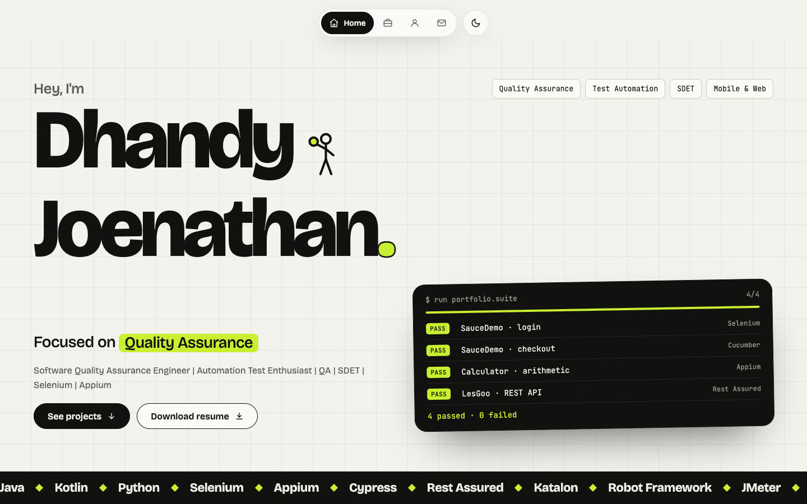

<div align="center">

# Dhandy Joenathan · Portfolio

**Software Quality Assurance Engineer · SDET**

A fast, accessible one-page portfolio. Its own test suite runs on every push.

[**Live site →**](https://dhandyjoe.github.io/)

[](https://github.com/dhandyjoe/dhandyjoe.github.io/actions/workflows/deploy.yml)


<picture>
  <source media="(prefers-color-scheme: dark)" srcset="docs/preview-dark.png" />
  
</picture>

</div>

## ✨ Highlights

- **Zero framework JS.** Static HTML from Astro. The theme toggle, scrollspy, project filters and test-runner animation are small inline scripts.
- **Light & dark themes.** Follows the OS setting, remembers your choice and sets the theme before first paint, so the page never flashes.
- **Accessible.** Checked against WCAG 2.1 AA with axe in both themes. Supports keyboard and screen readers, and respects `prefers-reduced-motion`.
- **Fast.** Self-hosted, preloaded fonts and responsive WebP images. CI fails if the Lighthouse scores drop.
- **Content as data.** Projects, tools and contact info live in typed files under `src/data/`.

## 🧰 Tech stack

| Area      | Choice                                                            |
| --------- | ----------------------------------------------------------------- |
| Framework | [Astro 7](https://astro.build), TypeScript `strictest`            |
| Styling   | Plain CSS with design tokens (no Tailwind/Bootstrap)              |
| Fonts     | Bricolage Grotesque + JetBrains Mono via Fontsource (self-hosted) |
| Images    | `astro:assets` (WebP, `srcset`)                                   |
| Testing   | Playwright e2e (desktop + mobile), axe-core, Lighthouse CI        |
| Hosting   | GitHub Pages via GitHub Actions                                   |

The reasoning behind these choices is in [`docs/adr/0001-tech-stack.md`](docs/adr/0001-tech-stack.md).

## 🚀 Getting started

```bash
nvm use        # Node 24 (.nvmrc); any Node ≥ 22 works
npm ci
npm run dev    # http://localhost:4321
```

Tests and Lighthouse use your installed **Google Chrome**, so there is no browser download.

## 📜 Scripts

| Command                | What it does                                                              |
| ---------------------- | ------------------------------------------------------------------------- |
| `npm run dev`          | Dev server with hot reload                                                |
| `npm run build`        | `astro check` (types) + production build to `dist/`                       |
| `npm run preview`      | Serve the built `dist/`                                                   |
| `npm test`             | Playwright e2e + axe on desktop (1440px) and mobile (390px); builds first |
| `npm run lhci`         | Lighthouse budgets on `dist/` (set `CHROME_PATH` if Chrome isn't found)   |
| `npm run format`       | Format everything with Prettier                                           |
| `npm run format:check` | Check formatting without writing (run in CI)                              |

## 🗂️ Project structure

```text
.
├── public/               # served as-is: favicon, robots.txt, cv/ (resume PDF)
├── src/
│   ├── assets/           # profile photo (optimised at build)
│   ├── components/       # one component per section: Nav, Hero, TestRunner, Projects, About, Contact, …
│   ├── data/             # projects.ts, tools.ts, site.ts ← edit content here
│   ├── layouts/          # Base.astro: <head>, SEO, JSON-LD, theme bootstrap
│   ├── pages/            # index.astro, 404.astro
│   └── styles/           # tokens.css (themes), motion.css (keyframes), global.css (layout)
├── tests/                # e2e.spec.ts, a11y.spec.ts
├── docs/adr/             # architecture decision records
└── .github/workflows/    # ci.yml (quality gates), deploy.yml (Pages)
```

## ✏️ Editing content

- **Add a project:** append an entry to `src/data/projects.ts`. Its `cat` must be one of `categories`. The filter tabs, counts and tests update automatically.
- **Skills / tools:** `src/data/tools.ts` feeds the scrolling band, the About list and the test-runner rows.
- **Name, links, email:** `src/data/site.ts`.
- **Resume:** replace the PDF in `public/cv/` (and update `site.resume` if the filename changes).
- **Layout:** desktop is the base CSS; mobile is `@media (max-width: 760px)` in `global.css`. Update both when you change a section.

## ✅ Quality gates

Every pull request, and every push to `master`, runs [`ci.yml`](.github/workflows/ci.yml):

1. `prettier --check`
2. `astro check` + build
3. Playwright e2e + axe (WCAG 2.1 AA, light & dark, desktop & mobile)
4. Lighthouse CI: performance ≥ 0.95; accessibility, best practices and SEO = 1.0

## 🚢 Deployment

When you push to `master`, [`deploy.yml`](.github/workflows/deploy.yml) runs the quality gates, builds with `withastro/action` and publishes with `actions/deploy-pages`.

> [!NOTE]
> One-time setup: **Settings → Pages → Source = GitHub Actions**.

The old URLs `/about.html` and `/contact.html` redirect to `/#about` and `/#contact`.

## 📫 Contact

[Email](mailto:dhanjoenkp@gmail.com) · [LinkedIn](https://www.linkedin.com/in/dhandyjoenathan/) · [GitHub](https://github.com/dhandyjoe/) · [Resume (PDF)](https://dhandyjoe.github.io/cv/DhandyJoenathan_QE_Resume_update.pdf)

<sub>© Dhandy Joenathan. All rights reserved.</sub>
